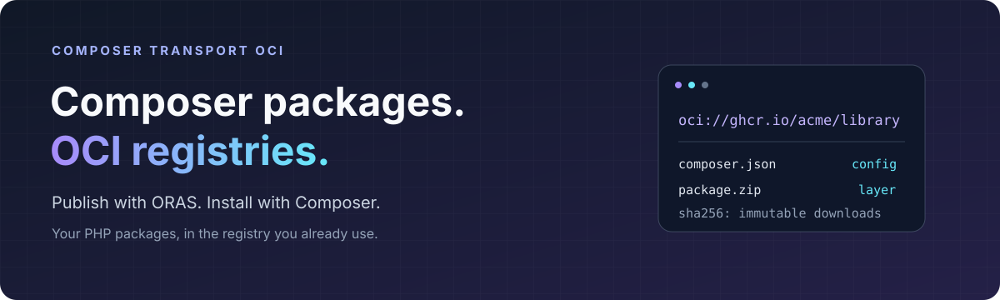

<p align="center">
  
</p>

<p align="center">
  <a href="https://packagist.org/packages/shyim/composer-transport-oci"></a>
  
  
  <a href="LICENSE"></a>
</p>

**Publish Composer packages to any compatible OCI registry—such as GitHub Container Registry—and install them with Composer.**

Push your release archives with [ORAS](https://oras.land/). This plugin lets Composer discover their versions, resolve dependencies, and install them from `oci://` URLs. Public libraries, private packages, and built release ZIPs can all use the same registry infrastructure as your containers.

- **Standard registry storage.** Package metadata and archives are OCI artifacts.
- **Normal Composer dependencies.** Keep your constraints, autoloading, and lock file.
- **Fast version lookup.** An optional index covers every release in two reads, or one with a warm cache, plus authentication.
- **Verified downloads.** SHA-256 checks protect metadata, archives, and cached content.
- **Existing credentials.** Use Composer authentication or credentials saved by `docker login`, including Docker credential helpers.

## Install the plugin

Requires **PHP 8.1+** and **Composer 2.9+**.

```sh
composer config allow-plugins.shyim/composer-transport-oci true
composer require shyim/composer-transport-oci
```

Install the plugin before adding your first OCI dependency. Keep it in `require` so production installs can use it too. Fresh installs from a lock file activate the plugin before downloading OCI packages.

## Publish a package

Start with your release archive, `package.zip`, and its `composer.json`. Create metadata for the version you are publishing:

```sh
jq '. + {version: "1.0.0"}' composer.json > package-metadata.json
```

This preserves the package's name, dependencies, autoload configuration, and other Composer metadata. Then push both files to your registry:

```sh
oras login ghcr.io

oras push ghcr.io/acme/library:1.0.0 \
  --config package-metadata.json:application/vnd.composer.package.v1+json \
  package.zip:application/zip
```

Replace `ghcr.io/acme/library` with your own registry and package path. Each OCI repository holds the releases of **one Composer package**. The Composer name comes from `composer.json`; it does not have to match the registry path.

ZIP, TAR, and gzip-compressed TAR archives are supported. See the [artifact format](docs/artifact-format.md) for media types and archive requirements.

## Install from your registry

Add the registry path to your project's `composer.json`:

```json
{
    "extra": {
        "oci-repositories": [
            "oci://ghcr.io/acme/library"
        ]
    }
}
```

Then require the package by its Composer name:

```sh
composer require acme/library:^1.0
```

`oci://` connects over HTTPS. Private registries use your [Composer or Docker credentials](docs/authentication.md). The resulting lock file pins the archive's content digest, so moving a release tag does not change an existing locked install.

Use `extra.oci-repositories` because Composer loads its ordinary repository definitions before activating plugins. No custom Composer build is needed.

### Repository options

Entries can be URL strings or objects:

```json
{
    "extra": {
        "oci-repositories": [
            {
                "url": "oci://ghcr.io/acme/library",
                "only": ["acme/library"],
                "canonical": true
            }
        ]
    }
}
```

Repositories take priority in the order listed and are canonical by default. `only` and `exclude` filter package names. Set `index` to `false` to force individual release-tag discovery.

## Fast, even with years of releases

Publish a `composer-index` artifact alongside your releases to make version discovery independent of the number of tags. It contains all Composer metadata and references the existing archive blobs.

| FroshTools: 120 releases on GHCR | Resolution time |
| --- | ---: |
| Individual release discovery | 40.6 s |
| Index, cold local cache | **2.3 s** |
| Index, warm local cache | **1.8 s** |

Single-run measurements from the same development environment, including registry authentication. Shopware and Symfony dependencies were treated as already satisfied to isolate OCI lookup time.

**Refresh the index after publishing or removing releases.** Repositories without an index work through automatic tag discovery. The [index guide](docs/index.md) includes the builder, publishing commands, cache behavior, and format.

## Registry compatibility

The artifact format uses OCI image manifests, blobs, and the Distribution API. It is designed for OCI-compatible registries that support custom artifact media types. **GHCR and a local CNCF Distribution registry have been tested**, including real downloads and locked installs.

Registry authentication policies still apply. For registries with a separate token-service hostname, see the [authentication guide](docs/authentication.md).

## Documentation

- [Artifact format](docs/artifact-format.md) — package metadata, archive types, and digest verification.
- [Version index](docs/index.md) — build and publish an index for fast lookups.
- [Authentication and limitations](docs/authentication.md) — Docker helpers, private registries, and supported behavior.
- [Development and testing](docs/development.md) — unit tests, static analysis, and registry integration checks.

## License

[MIT](LICENSE).
